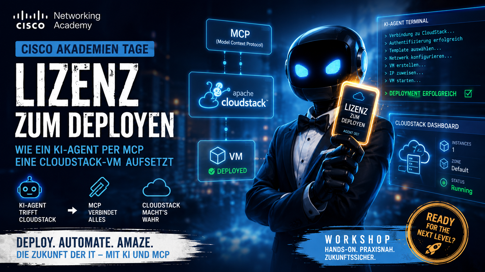

# Lizenz zum Deployen

**Wie ein KI-Agent per MCP eine CloudStack-VM aufsetzt** – Workshop für Lehrkräfte bei den Cisco Akademientagen 2026

| | |
|---|---|
| **Termin** | Montag, 16.11.2026, 12:00–13:00 Uhr, Raum E17 |
| **Dauer** | 60 Minuten |
| **Zielgruppe** | Lehrkräfte |
| **Referent** | Dr. Jörg Tuttas, Multi-Media Berufsbildende Schulen (MMBbS) Hannover |

## Worum geht es?

Ein Fachinformatiker Systemintegration der fiktiven *Change IT GmbH* soll eine CloudStack-Umgebung inventarisieren, ein Dashboard für die Geschäftsführung erstellen und eine Test-VM bereitstellen. Im Workshop übernimmt Claude Desktop diese Aufgaben über einen MCP-Server, der als Desktop Extension (`.mcpb`) an die CloudStack-API angebunden ist. Anschließend deployen die Teilnehmenden selbst eine Linux-VM mit öffentlicher IP und melden sich per SSH an.

## Inhalt des Repositorys

| Ordner | Inhalt |
|---|---|
| `01_Organisation/` | Flyer zum Workshop |
| `02_Skript/` | Workshop-Skript (Ablauf, Demo-Prompts, Vorbereitung, Sicherheit, Plan B) |
| `03_Praesentation/` | PowerPoint-Präsentation |
| `04_Handout/` | Handout für Teilnehmende (1 Seite A4, PDF) |
| `05_MCP-Server/` | Desktop Extension `cloudstack-mcp-workshop.mcpb` für Claude Desktop |
| `06_Bilder/` | Teaser-Grafik und Screenshots |

## MCP-Server installieren

1. Claude Desktop installieren und anmelden.
2. `05_MCP-Server/cloudstack-mcp-workshop.mcpb` herunterladen und per Doppelklick öffnen – oder in Claude Desktop unter *Einstellungen → Erweiterungen* hineinziehen.
3. Bei „CloudStack (MMBbS Workshop)“ auf **Konfigurieren** klicken, API-Key und Secret-Key des eigenen CloudStack-Accounts eintragen und die Erweiterung aktivieren.
4. Verbindungstest in Claude: *„Welche Zonen stehen mir zur Verfügung, und welche VMs habe ich bereits?“*

Der MCP-Server basiert auf [phantosmax/cloudstack-mcp-server](https://github.com/phantosmax/cloudstack-mcp-server) (MIT-Lizenz).

## Link & QR-Code

https://github.com/jtuttas/cloudstack-mcp-workshop

## Kontakt

Dr. Jörg Tuttas · MMBbS Hannover · tuttas@mmbbs.de
